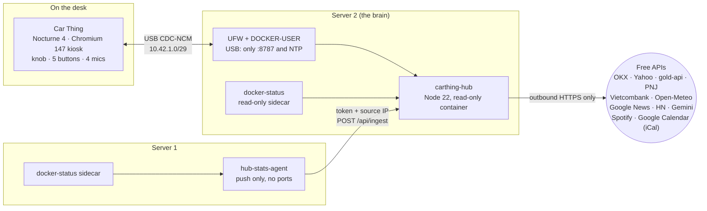

<div align="center">

# Car Thing Desk Hub

**A bricked Spotify Car Thing, reborn as a desk companion:** live markets, news, weather, your calendar, Spotify, server health, a focus timer, and **Mei**, a little yellow cat you can talk to.


<sub>Recorded from the real device (800 × 480) over DevTools, not a mock-up. Every screenshot below is from the device too.</sub>

[Features](#features) · [Gallery](#gallery) · [How it works](#how-it-works) · [Setup](docs/SETUP.md) · [Dev log (Tiếng Việt)](docs/DEVLOG.md) · [Security](docs/SECURITY.md)

</div>

---

Spotify switched the Car Thing off in December 2024. Under the hood it is still a capable little Linux box: a 4" touchscreen, a big clicky knob, four preset buttons, a back button, four microphones, and USB. This project keeps the community firmware ([Nocturne](https://github.com/usenocturne/nocturne)) as the operating system, and replaces what the screen shows with a dashboard served from a small home server over the USB cable.

The Car Thing never touches the internet. It only talks to the hub, the hub only talks to free public APIs, and the network is locked so the device can reach exactly one port.

## Features

| | |
|---|---|
| 📰 **News** | Top stories, Việt Nam, Kinh doanh VN, Tech and Hacker News, refreshed every 2 minutes from Google News RSS and the Hacker News API. Tap a headline, or select it with the knob, for a one-paragraph summary of the actual article, in Vietnamese or English. |
| 📈 **Markets** | BTC with a rolling odometer price and a 24 h chart; ETH, SOL, BNB, XRP and DOGE streamed in real time over the OKX websocket; gold and silver; SJC and 9999 ring gold in VND; Vietcombank FX; VN-Index, S&P 500, Nasdaq, DXY and oil. Price alerts pop up on any page. |
| 🐈 **Mei** | Press the knob and talk. The four microphones record, the hub asks Gemini, and Mei answers in English or Vietnamese in a speech bubble. She remembers the last few minutes, so follow-ups work, and knows which story you had open ("what does this one say?"). Every morning at 7 she writes a short **briefing**: weather, today's calendar, BTC and gold, USD/VND, top headlines. While idle, Mei and her owner **Nhat** act out random little scenes. |
| 🌤 **Weather** | Current conditions, AQI, 12-hour and 4-day forecast (Open-Meteo). The animated sky changes with the real weather. |
| 📅 **Calendar** | Your Google Calendar through its secret iCal link (read-only, no OAuth): what's next with a countdown, then today, tomorrow or the week. Recurring events, exceptions and daylight-saving changes are handled on the hub. A banner pops up 10 minutes before each event, on any page. |
| 🎵 **Music** | Spotify now playing and controls (PKCE, no client secret), album art proxied through the hub. |
| 🖥 **Servers** | CPU, memory, disk, temperature, uptime and container health for two home servers. |
| ⏱ **Focus** | A Pomodoro timer: buttons 1–4 set 15, 25, 45 or 60 minutes. |
| ⚙️ **Quick menu** | The round button opens screen brightness, restart, shut down and rotate (each press turns the screen another 90°). |
| 🔌 **Self-healing** | If the hub goes quiet the screen says so and keeps reconnecting, and it reloads itself when the hub comes back with new code. A watcher on the device restarts the kiosk if it got stuck on an error page, and the hardware watchdog reboots it if it ever freezes. |

### Controls

| Control | What it does |
|---|---|
| **Knob (turn)** | Change page; inside a mode it moves through that mode instead |
| **Knob (press)** = Enter | The page's main action: pick stories on News, talk to Mei, volume on Music, start the timer on Focus |
| **Back** (button beside the knob) | Leave whatever you entered: a story summary, story selection, a zoomed market view, volume mode, Mei's answer |
| **Buttons 1–4** | Depend on the page; small numbered badges on screen show what each one does |
| **Round button** | Quick menu |

| Page | 1 | 2 | 3 | 4 |
|---|---|---|---|---|
| News | Top stories | Việt Nam | Tech | Next topic |
| Markets (zoom) | BTC | Gold | FX | Indices |
| Mei | Today's briefing | | | |
| Calendar | Today | Tomorrow | Week | |
| Music | Previous | Play / pause | Next | Like |
| Focus | 15 min | 25 min | 45 min | 60 min |

On **News**: press the knob to highlight a story, turn to move, press again (or just tap the story) for its summary. While a summary is open, turning the knob flips to the next story. Turn to Mei with the summary still open and ask her about it.

## Gallery

| | |
|---|---|
| <br>**News**, five topics, buttons 1–4 | <br>**Story summary** (tap a headline) |
| <br>**Picking a story** with the knob | <br>**Markets → BTC** (button 1) |
| <br>**Markets → Gold** (button 2) | <br>**Markets → FX** (button 3) |
| <br>**Mei answering** a spoken question | <br>**Mei and Nhat**: the fish sandwich heist |
| <br>**Calendar** (sample events) | <br>**Mei's morning briefing** |
| <br>**Weather** | <br>**Servers** |
| <br>**Music** | <br>**Quick menu** (round button) |

<details>
<summary><b>Portrait mode</b> (rotate from the quick menu)</summary>
<br>
<p align="center">


</p>
</details>

<details>
<summary><b>More</b>: indices zoom, calendar week, focus timer, more of Mei and Nhat</summary>
<br>
<p align="center">


</p>
</details>

## How it works



* **The Car Thing is a screen, not a computer you trust.** It runs Chromium in kiosk mode pointed at the hub, plus two tiny shell helpers: one applies the brightness you pick, the other records the microphones when you talk to Mei. It has no route to the LAN or the internet.
* **The hub is the brain.** One Node.js process with no dependencies gathers every data source, keeps all keys, and streams state to the screen over Server-Sent Events. It runs in a read-only container with every capability dropped and no `docker.sock`.
* **Everything is free.** No paid API is required. The two optional extras that would cost money (Google Search grounding for Mei, and paid Gemini tiers) are off by default. When the main Gemini model runs out of its free daily quota, Mei switches to Flash-Lite on her own.

More detail: **[docs/ARCHITECTURE.md](docs/ARCHITECTURE.md)** · the whole story of how it was built, what broke, and why each decision was made: **[docs/DEVLOG.md](docs/DEVLOG.md)** (Vietnamese).

## Repository layout

```
hub/            the brain: Node 22 server, UI, config, compose file
  server/       index.mjs (data sources, HTTP/SSE), assistant.mjs (Mei), news.mjs, calendar.mjs,
                spotify.mjs, alerts.mjs, docker-status.mjs
  test/         node:test suite (calendar recurrence and time zones)
  public/       index.html, app.js (pages + controls), stage.js (Mei & Nhat),
                style.css + theme.css, fonts/ (Bricolage Grotesque, OFL)
agent/          server-1 stats agent (push only) + its compose file
carthing/       files that live on the Car Thing: helpers, kiosk override and watcher, sshd, NTP, watchdog
host/           server-2 host config: netplan, UFW / DOCKER-USER rules, sysctl, chrony
tools/          setup scripts for secrets, DevTools helpers (screenshots, the GIF, error capture)
docs/           SETUP, ARCHITECTURE, SECURITY, DEVLOG, screenshots
```

## Getting started

See **[docs/SETUP.md](docs/SETUP.md)**. In short: flash Nocturne 4 onto the Car Thing, plug it into a Linux box running Docker, apply the host network and firewall config, copy `hub/.env.example` to `hub/.env`, `docker compose up -d`, and point the kiosk at the hub.

## Credits

* [Nocturne](https://github.com/usenocturne/nocturne): the firmware that makes the Car Thing usable again. This project runs on top of it and only replaces the page the kiosk shows.
* [flashthing](https://github.com/JoeyEamigh/flashthing): flashing tool.
* Data: [OKX](https://www.okx.com/docs-v5/), Yahoo Finance, [gold-api.com](https://gold-api.com), PNJ, Vietcombank, [Open-Meteo](https://open-meteo.com), Google News RSS, [Hacker News API](https://github.com/HackerNews/API), [Gemini API](https://ai.google.dev), [Spotify Web API](https://developer.spotify.com).
* Typeface: [Bricolage Grotesque](https://github.com/ateliertriay/bricolage) (SIL Open Font License, see `hub/public/fonts/OFL.txt`).

This is a personal project and is not affiliated with Spotify, Nocturne, or any data provider. Respect each provider's terms; some of the endpoints used here are unofficial.

## License

[MIT](LICENSE)
